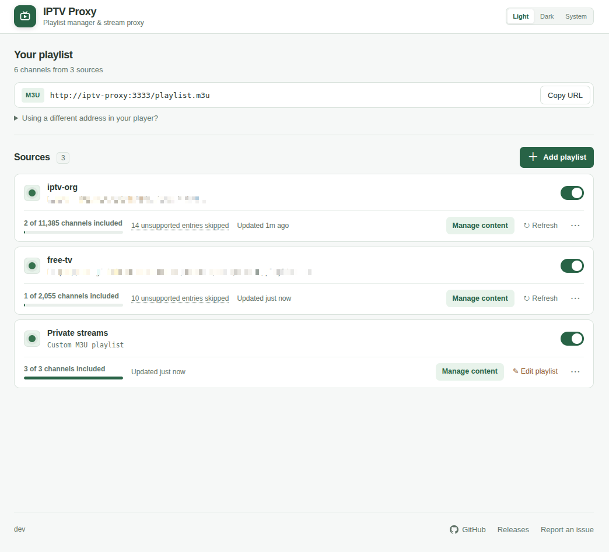
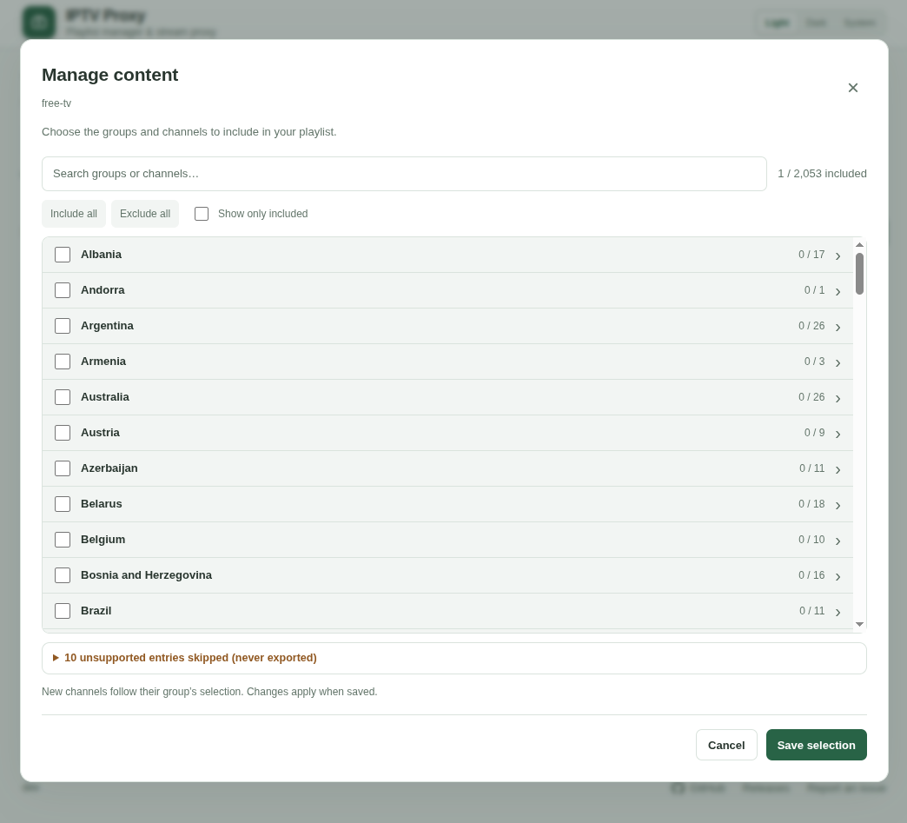
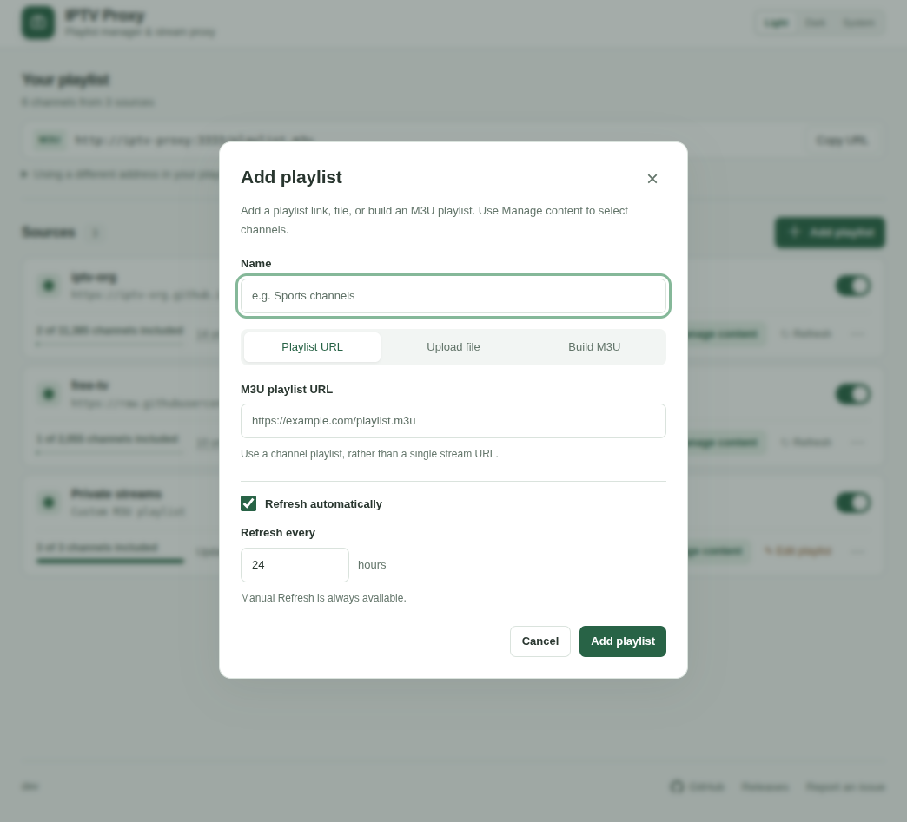
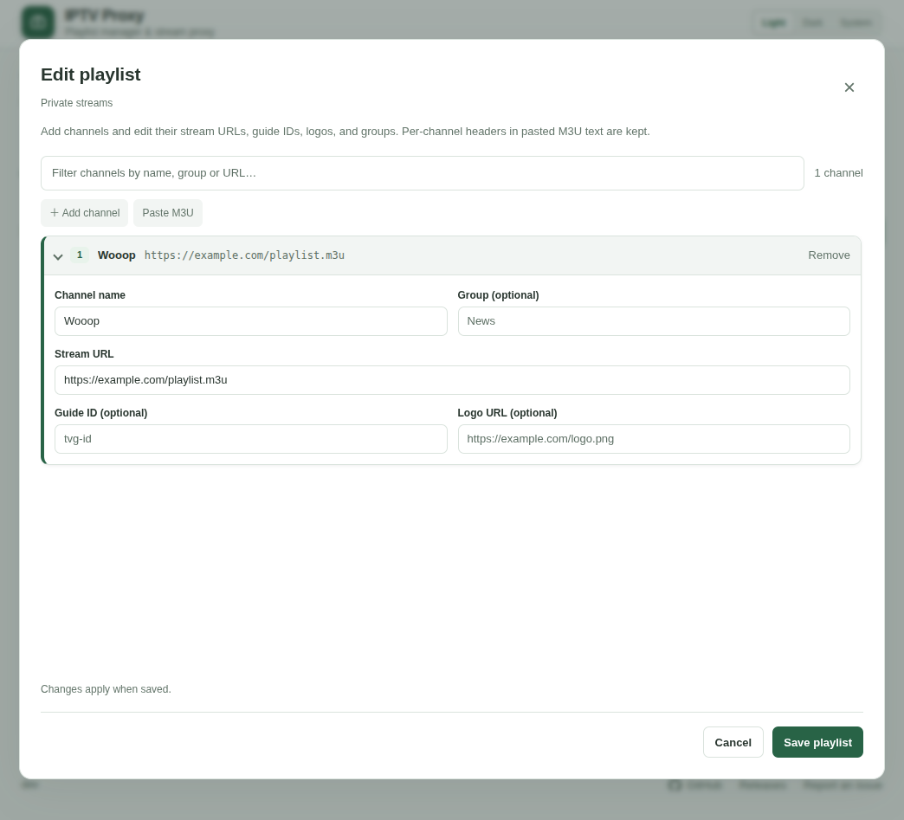

# IPTV header proxy

Turns one or more channel M3U playlists into a single playlist that any IPTV player can
use, even when the provider requires special request headers. The proxy reads each
channel's headers, fetches the stream on the player's behalf, and rewrites HLS URLs so
nested playlists, alternate audio/subtitles, init segments, media segments and key
requests use the same headers. Video is streamed through without transcoding or recording.
A web UI manages sources and chooses which channels are exported.

<p align="center">
  <a href="screenshots/manager.png?raw=true"></a>
  <a href="screenshots/manage-content.png?raw=true"></a>
</p>
<p align="center">
  <a href="screenshots/add-playlist.png?raw=true"></a>
  <a href="screenshots/edit-playlist.png?raw=true"></a>
</p>

<p align="center"><sub>Click a screenshot to view it full size.</sub></p>

## Quick start

```yaml
services:
  iptv-proxy:
    image: ghcr.io/railadeividas/iptv-proxy:latest
    restart: unless-stopped
    ports:
      - "3333:3333"
    volumes:
      - iptv-proxy-data:/data

volumes:
  iptv-proxy-data:
```

Open **http://localhost:3333/**, add a playlist (URL, uploaded file or hand-built M3U), use
**Manage content** to pick the channels to export, then give your player the **Copy URL**
address, for example `http://192.168.1.10:3333/playlist.m3u`. New sources export nothing until
you select content.

## Configuration

Configured with environment variables, all optional:

| Environment variable | Default | Purpose |
| --- | --- | --- |
| `UI_PASSWORD` | empty (no password) | Show a sign-in page and require this password to open the manager. Sessions last 30 days, or until the container restarts. |
| `PLAYLIST_SOURCE` | empty | URL (or mounted file path) imported once as the first source on a new installation. |
| `SIGNING_KEY_FILE` | `/data/signing.key` | Where the key for signed stream links is stored. Its folder also holds all saved state. |

Mount `/data` as a volume. It holds `sources.json`, `content.json`, uploaded and custom
playlists, copies of remote playlists and the signing key. These files may contain provider
URLs and tokens, so treat backups accordingly. If `sources.json` or `content.json` is
damaged, the proxy refuses to start and names the file.

## Playlist format

Normal `.m3u`/`.m3u8` playlists work unchanged; a missing `#EXTM3U` line is accepted.

```m3u
#EXTM3U
#EXTINF:-1 tvg-id="channel.one" group-title="Sports",Channel One (720p)
#EXTVLCOPT:http-referrer=https://provider.example/
#EXTVLCOPT:http-user-agent=Mozilla/5.0
https://cdn.provider.example/live/channel-one/index.m3u8
```

Supported request headers are Referer (also Referrer), User-Agent, Origin, Cookie,
Authorization and Accept, in any of these forms. Headers reset for every channel.

```m3u
#EXTVLCOPT:http-origin=https://provider.example
#EXTHTTP:{"Referer":"https://provider.example/","User-Agent":"Mozilla/5.0"}
#EXTINF:-1 http-referrer="https://provider.example/",Name
https://cdn.provider.example/stream.m3u8|Referer=https%3A%2F%2Fprovider.example%2F
```

- `#EXTINF` attributes and `#EXTGRP` are kept. `http-*` attributes are used by the proxy
  but removed from the exported playlist, so credentials never reach players.
- Entries that are not HTTP(S) URLs, or have malformed headers, are skipped and listed
  under **Manage content** with the reason. One bad entry never rejects the whole source.
- Not supported: DASH rewriting, RTSP, DRM licensing, catch-up templates, VLC program
  selection, Kodi properties and browser-based authentication. Sources must be real media
  URLs, and cookies or tokens must still be valid; the proxy does not refresh them.
- A remote source must be a channel list with `#EXTINF` entries, not a single HLS master
  playlist. Playlists and manifests are limited to 16 MiB.

## How it behaves

- **Addresses:** every generated URL uses the host and port the client connected to, so
  `http://localhost:3333/` and `http://192.168.1.10:3333/` each get matching links.
  `X-Forwarded-Host` is ignored; `X-Forwarded-Proto: https` switches links to `https://`.
  Use an address your player can reach; the UI's optional "address for your player" field
  only changes the URL it copies.
- **Stable channel URLs:** channels are exported as `/channel/<id>.m3u8`. The id depends on
  the source, TVG ID, name, group and duplicate position, not on provider tokens, so token
  rotation doesn't break your player's channel list. The provider URL and headers are
  resolved at play time. Re-import the playlist in your player if you change its address.
- **Content selection:** per source, with group rules and per-channel overrides. A channel
  is matched by TVG ID, name and group. New channels follow their group's rule, or the
  source default. Excluded channels also return 404 for old signed links.
- **Refresh:** each source refreshes on its own schedule (in hours, or manual only). A failing
  provider keeps its last good channel list, also across restarts, and never blocks others.
  `/playlist.m3u` answers 503 until the first load finishes, so players never import an
  empty list at startup.
- **Streaming:** range requests are forwarded, `HEAD` is answered from an upstream `GET`,
  compressed manifests are decoded, and cookies and credentials are dropped on redirects
  to another host. Upstream timeout is 30 seconds. `/healthz` is a process health check.

## Security

The proxy is meant for a trusted private network. Do not expose it to the internet.

- The player endpoints (`/playlist.m3u`, `/channel/*`, `/stream*`) have no login. Stream
  targets are signed, so callers cannot point the proxy at arbitrary URLs.
- To keep the manager off your network, publish the port on localhost only (`127.0.0.1:3333:3333`).
- Set `UI_PASSWORD` to protect the manager with a sign-in page. Players don't need it. Sessions use random IDs kept on the server, so signing out ends them for real. Wrong guesses are limited to 8 per minute per address.
- Management writes need a token that changes whenever the proxy restarts.
- Behind a TLS reverse proxy the sign-in cookie gets the `Secure` flag and links use `https://`
  automatically. Plain HTTP keeps working without it. Example for nginx:

  ```nginx
  location / {
      proxy_pass http://127.0.0.1:3333;
      proxy_set_header Host $http_host;               # generated links use this host
      proxy_set_header X-Forwarded-Proto $scheme;     # https links and Secure cookie
      proxy_buffering off;                            # stream video as it arrives
      proxy_read_timeout 1h;
      client_max_body_size 32m;                       # playlist uploads
  }
  ```
- Treat source playlists as trusted configuration: configured headers also go to other
  hosts referenced by HLS manifests.
