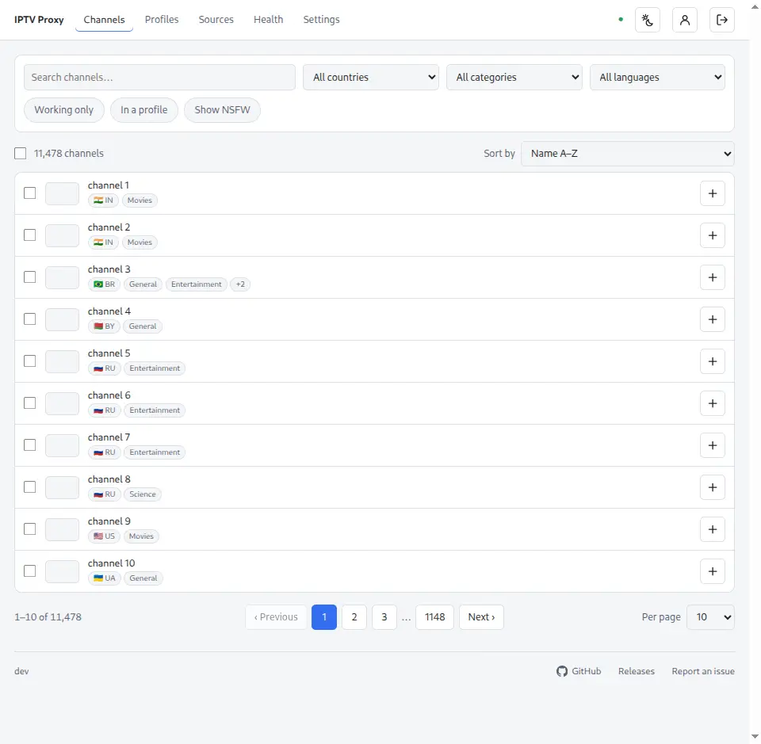
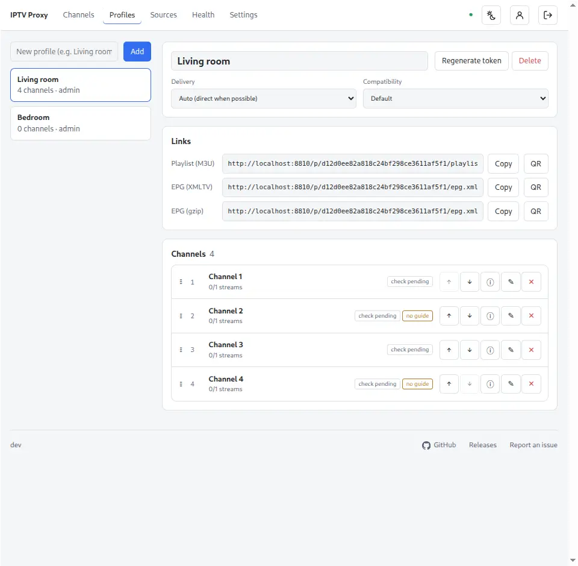
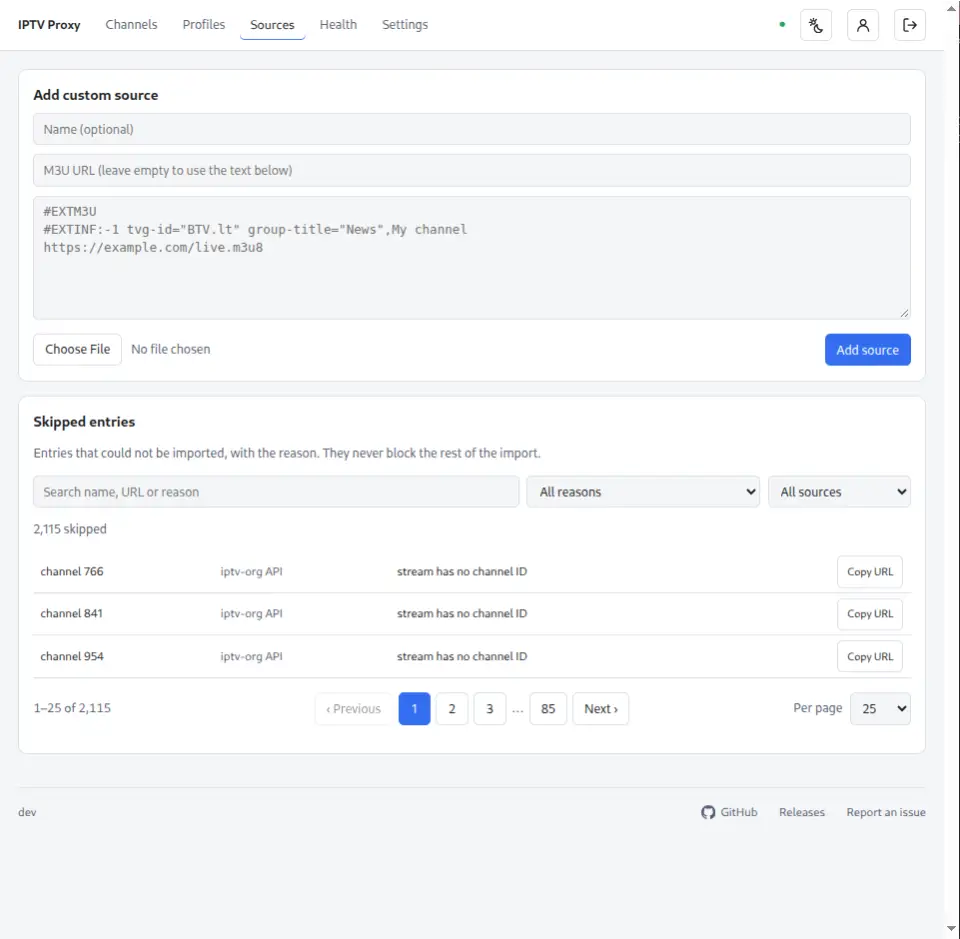
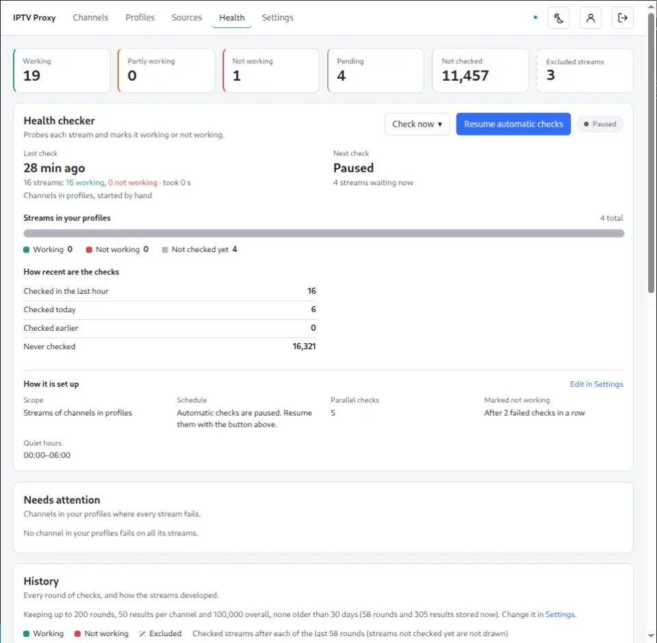
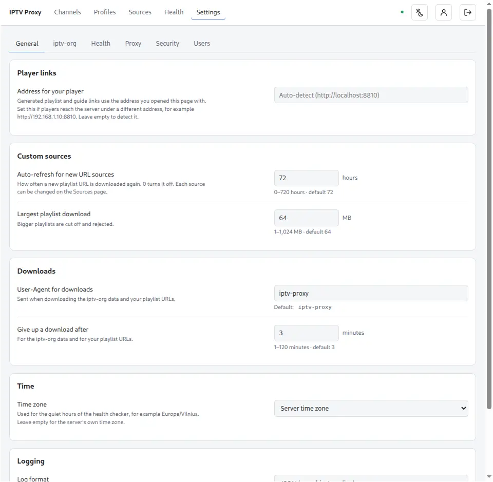
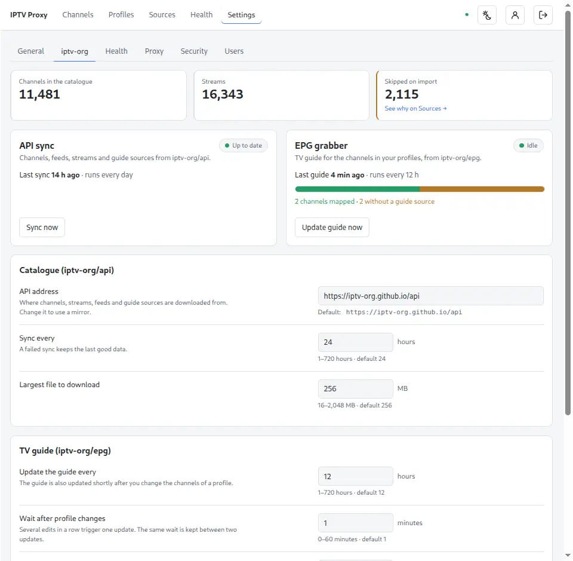

# IPTV Proxy

Your own IPTV in one Docker container. Browse the [iptv-org](https://github.com/iptv-org) channel catalogue (or bring your own
playlists), pick channels into named profiles, and get a **playlist (M3U)** and a **TV guide (XMLTV)** link for each profile.
A built-in proxy fixes headers (Referer / User-Agent / Origin) and compatibility, so the streams play in any player: VLC, Kodi,
TiviMate, a smart TV, a browser. A health checker keeps dead streams out of your playlists.

- Browse and filter 11,000+ channels, select many at once, add them to profiles
- One playlist and one guide link per profile, QR codes for TVs, links you can revoke
- Streams are proxied only when they need it; HLS and DASH are supported
- Automatic health checks with history, reasons and a "needs attention" list
- Your own M3U sources by URL, file or pasted text
- Several users with roles: user, admin, superuser
- Everything is configured in the UI, nothing through environment variables

<p align="center">
  <a href="screenshots/channels.webp?raw=true"></a>
  <a href="screenshots/profiles.webp?raw=true"></a>
</p>
<p align="center">
  <a href="screenshots/sources.webp?raw=true"></a>
  <a href="screenshots/health.webp?raw=true"></a>
</p>
<p align="center">
  <a href="screenshots/settings1.webp?raw=true"></a>
  <a href="screenshots/settings2.webp?raw=true"></a>
</p>

<p align="center"><sub>Click a screenshot to view it full size.</sub></p>

## Quick start

```sh
docker run -d --name iptv-proxy -p 8810:8810 -v iptv:/data --restart unless-stopped ghcr.io/railadeividas/iptv-proxy
```

or with Docker Compose. Save this as `compose.yml`:

```yaml
services:
  iptv-proxy:
    image: ghcr.io/railadeividas/iptv-proxy:latest   # or pin a version, for example :1.2.0
    container_name: iptv-proxy
    ports:
      - "8810:8810"
    volumes:
      - iptv:/data      # database, settings and generated guide files
    restart: unless-stopped

volumes:
  iptv:
```

and start it:

```sh
docker compose up -d
```

To build the image yourself instead, run `docker compose up -d --build` in a checkout of this repository (its
`compose.yml` builds from the `Dockerfile`).

Open <http://localhost:8810>.

1. **First start:** a setup page asks you to create the **superuser** account. Whoever opens the page first creates it, so do this
   before you expose the port to a network you don't trust.
2. The catalogue downloads in the background (a minute or two). The header shows "Loading channel data…" until it is ready.
3. On **Channels**, tick some channels and **Add to profile…**. A profile can be created right there.
4. On **Profiles**, copy the **Playlist** and **EPG** links into your player. The QR button helps on a TV.

If the app runs behind a different address than the one you open it on (a domain, a reverse proxy), set **Address for your player**
in Settings so the generated links use it.

## Pages

| Page | What it is for |
|---|---|
| **Channels** | The catalogue. Search; filter by country, category, language, source, *Working only* (also partly working), *In a profile*, *Show NSFW*; sort by name, country, status or stream count. Tick rows (a page, or *all N matching*) and add them to a profile in one go. Click a row for its details: country, categories, languages, network, website, guide sources, every stream with its last result, and the stored check history. Your filters are remembered while you move between pages. |
| **Profiles** | One playlist for one player or person. Rename, choose the delivery mode and a compatibility User-Agent, regenerate the token, and manage the channels: reorder (drag or arrows), rename a channel, set its guide ID, prefer a stream, override its delivery mode, remove it. Changes are saved with the sticky save bar. |
| **Sources** | Your own playlists: add an M3U by URL, file or pasted text, edit it in a modal, refresh it, let URL sources refresh by themselves. Below them, **Skipped entries**: lines the importer could not use, with the reason, filterable by reason and source. |
| **Health** | The health checker (see below). |
| **Settings** | Superuser only: every tunable value, grouped in tabs (see [Configuration](#configuration)). |

The UI is a Vue 3 single-page app with real browser history (filters, pages and profiles are in the URL), live updates over a
WebSocket (sync and guide progress, stream status, edits made in another tab) and a light, dark or system theme.

## How it works

- **Catalogue.** `channels`, `streams`, `feeds`, `guides`, `logos` and more come from the [iptv-org/api](https://github.com/iptv-org/api)
  at runtime, into SQLite in `/data`. Downloads are ETag-aware and follow the sync interval in Settings. A failed sync keeps the last
  good data. Playlist endpoints answer `503` until the first sync has finished. Streams without a valid channel ID are skipped
  and listed on the Sources page.
- **TV guide.** The image bundles [iptv-org/epg](https://github.com/iptv-org/epg). After profile changes, and on the interval in
  Settings, the app writes the channel list for the selected channels, runs the grabber, validates the result and swaps it in
  atomically (the last good guide survives a failure). `tvg-id` equals the XMLTV id (`Channel.xx@Feed`). Each profile gets its own
  filtered `epg.xml` and `epg.xml.gz`. A channel without a guide can borrow one by entering a guide ID in the profile.
- **Stable links.** A playlist points at `/p/{token}/channel/{id}.m3u8`; the real stream address and its headers are resolved when
  you press play. Depending on the delivery mode the app **redirects** to the stream (default *Auto*: only when no special headers
  are needed) or **proxies** it. If a stream fails, the next stream of that channel is tried.
- **Proxy.** HLS (master and media playlists, keys, init segments, alternate audio and subtitles) and DASH (`BaseURL`,
  `SegmentTemplate`, `SegmentList`) manifests are rewritten so everything flows through HMAC-signed links (`/x/…`, and `/xd/…` for
  DASH directories). The proxy cannot be used to fetch arbitrary URLs. Range requests, `HEAD`, compressed manifests, CORS,
  MIME fixes, a short segment cache and a connection limit are built in; cookies and credentials are dropped on cross-host
  redirects. There is no transcoding or recording. Limits and timeouts are settings.
- **Compatibility profiles.** Per profile, force a VLC, browser or ExoPlayer User-Agent for streams that don't define one.

## Health checks

The checker probes streams in the background and gives every stream one of three states: *working*, *not working* or *not checked
yet*. A channel with at least one working stream counts as working; a channel whose streams all fail is **hidden from playlists**
and listed on the Health page.

- **What is checked.** By default the channels in your profiles, again every 24 hours. The scope can be every stream, only channels in
  profiles, or nothing automatic. **Quiet hours** (with a time zone, by default 00:00–06:00) pause the automatic checks at chosen times.
- **When a stream counts as not working.** After a number of failed checks in a row (default 2). A stream that was never checked has no
  earlier result to protect, so its first failure counts at once. Failed streams are tried again after an hour. A viewer whose
  playback fails marks the stream immediately. Each failure keeps its reason: timed out, HTTP 404, returned a web page, and so on.
- **What a check does.** One request per stream, with the stream's own User-Agent and referrer. An HLS master playlist is followed to
  its first variant, which must list segments; a DASH manifest must have a period; a direct stream must send data that is not a web
  page or text. Segments themselves are not downloaded. A working result notes the format the stream serves (HLS, DASH, MPEG-TS,
  MP4, …). Five checks run at once by default (*Parallel checks*), and checks against one server run one at a time (*Parallel checks per server*).
- **Excluding streams.** A stream can be left out of health checks: *Exclude from checks* in a channel's details. A stream whose every
  check has failed for a number of days (default 7, *Stop checking a stream that has failed for* in Settings, 0 never) is excluded
  automatically; one working check or working playback starts the count again. An excluded
  stream keeps its last result and is skipped by automatic rounds and by checks started by hand. **Excluded streams** on the Health
  page lists them with the date since when and why, a link to the channel's details and *Include again*.
- **Channel status.** A channel is **working** when it has a working stream and none failing, **partly working** when some
  streams work and some fail, and **not working** when every stream fails. Streams excluded from checks do not count, unless
  all of a channel's streams are excluded.
- **The page.** Five tiles count channels and always add up to all channels: **Working**, **Partly working**, **Not working**,
  **Pending** (will be checked, no result yet) and **Not checked** (outside the scope); another tile counts the **Excluded
  streams**. The stream bars and the history chart show excluded streams apart from working and not working. **Needs attention** lists channels in profiles where every
  stream fails, with a hint on what the reason usually means, search, filter by reason, *Re-check*, *Re-check all failing* and
  *Remove from profiles…*. The checker card shows the last check, the next check, progress while running and how it is set up.
- **Check now.** Check by hand: channels in profiles, every stream, only streams marked not working, only streams not checked yet,
  one profile, one source, or one channel. You can pause automatic checks, and stop a running check at any time (interrupted
  probes are never counted as failures).
- **History.** Every round is stored and charted (working and not working after each round), and each has a **Results** view with
  the channel-by-channel results, failures first. Each channel keeps its own check history, shown in its details. How much is kept
  (rounds, results per channel, results overall, how many days) is set in Settings.

## Users and roles

Everyone signs in with a user name and password. What each role may do lives in one place, `internal/auth`:

| Role | Can |
|---|---|
| **User** | Browse channels and manage their **own** profiles only. |
| **Admin** | Also see and edit everyone's profiles, and use **Sources** and **Health**. No **Settings**. |
| **Superuser** | Everything, including Settings and the **Users** tab (create, edit and delete users, make admins). There is exactly one: the account made on the first start. It cannot be deleted or demoted. |

**Lost the superuser password?** Run the recovery command next to the app. It needs access to the data directory, which already means
full control of the installation. It sets a new random password and prints it once; everyone signed in as that user is signed out:

```sh
docker compose exec iptv-proxy iptv-proxy reset-password            # the superuser
docker compose exec iptv-proxy iptv-proxy reset-password alice      # any other user, by name
# plain docker:  docker exec iptv-proxy iptv-proxy reset-password
```

It works while the app is running. Sign in with the printed password, then click your name in the header to choose your own.

Deleting a user also deletes their profiles. A new password signs that user out everywhere. Everyone can change their own password
by clicking their name in the header. Channels and profile ids are scoped on the server, so one user never learns about another
user's profiles.

## Configuration

There are **no environment variables**. Accounts are made in the app; everything else is a **setting**, edited under **Settings** and
applied immediately, without a restart. Each field shows its range and default, and invalid values are rejected with a message.
Settings live in the database (the `/data` volume).

| Tab | What you can tune |
|---|---|
| **General** | Address for your player links, defaults for custom sources (auto-refresh, default every 72 hours; largest download), download timeout and User-Agent, time zone, log format |
| **iptv-org** | API address, sync interval and download limit, guide interval, parallel downloads, days of programmes, timeout and the wait after profile changes; also the sync and guide status, with a button to run each now |
| **Health** | Which streams to check and how often, failed checks in a row, retry time, when to stop checking a failing stream, quiet hours, history limits, parallel checks (in total and per server, default 1 per server), timeouts, User-Agent |
| **Proxy** | Most streams at once, upstream timeouts, how long proxy links stay valid, manifest and segment-cache limits, default and compatibility User-Agents |
| **Security** | How long you stay signed in, failed sign-in limit and window, shortest password |
| **Users** | Create, edit and delete users and make admins |

Only deployment paths are command-line flags, with the image's defaults: `-listen :8810`, `-data /data`, `-epg /opt/epg`.

Open endpoints: `/healthz`, `/p/{token}/…` (the playlist, guide and channel links, protected by the profile token) and `/x/…`
(signed proxy links). Everything else is the admin UI and API behind sign-in.

## Upgrading

Pull the new image (or rebuild) and restart: your profiles, users, custom sources, settings and check history stay. When a new
version changes the database layout, the app migrates it automatically at startup. Before it does, it writes a copy of the database
next to it, as `iptv.db.bak-v<version>` in the data volume, and every migration step is one transaction, so a step that fails
leaves the database as it was and the app stops with a message saying which step failed. Read the release notes before a new version.

Playlist and guide links, the `/data` layout and the settings keep working across versions.

**Rolling back.** The app refuses to start on a database made by a newer version, so an older image never damages it. To go back,
stop the app, restore the copy made before the upgrade, and start the older image:

```sh
docker compose down
docker compose run --rm --no-deps --entrypoint sh iptv-proxy -c 'cd /data && rm -f iptv.db-wal iptv.db-shm && cp iptv.db.bak-v4 iptv.db'
# set the older image tag in compose.yml, then:
docker compose up -d
```

(Replace `4` with the version in the backup's name. Changes made after the upgrade are lost.) Databases from development builds before
database version 4 cannot be migrated: delete `iptv.db`, `iptv.db-wal` and `iptv.db-shm` and start again, and the catalogue downloads
again.

## License

Released into the public domain under the [Unlicense](LICENSE). Anyone may use, change, sell or redistribute the code or the app for any
purpose, with no conditions. It comes **as is, with no warranty, and the author takes no responsibility for it or for what anyone does
with it**.

This is a tool for playing streams you choose. It does not host, provide or endorse any channel or content; what you add, watch or
share with it, and whether that is legal where you live, is up to you.

The packages bundled in the app keep their own licences, reproduced in [`THIRD_PARTY_NOTICES`](THIRD_PARTY_NOTICES) (also in the
image, in `/licenses`).

## Security notes

- Proxying uses **your** bandwidth; keep *Auto* or *Redirect* where headers aren't needed.
- Profile tokens are secrets. Use **Regenerate token** if a link leaks. Prefer a LAN or VPN; if the app is public, put it behind HTTPS.
- Sign-in attempts are rate limited per address (a setting). Sessions stop working when the password changes or the user is deleted.
- Custom sources may point at private-network hosts, so only make people admins whom you trust.

## Reverse proxy (nginx)

```nginx
location / {
  proxy_pass http://127.0.0.1:8810;
  proxy_set_header Host $host;
  proxy_set_header X-Forwarded-Proto $scheme;
  proxy_buffering off;          # live streams
  proxy_read_timeout 3600s;
}
```

## Releases and CI

- **CI** (`.github/workflows/ci.yml`) builds the UI, runs `go vet` and `go test`, and builds the binary on every pull request and
  push to `main`.
- **Release** (`.github/workflows/release.yml`) builds a multi-architecture image (`linux/amd64`, `linux/arm64`) and pushes it to
  `ghcr.io/<owner>/<repo>`. Push a tag such as `v1.2.0` to publish `1.2.0` and `latest`. A weekly run (Monday) and the manual
  *Run workflow* button rebuild `latest`, which picks up updates to the guide grabber.
- **Version.** The running version is shown as a badge next to the name in the header, and in the startup log. A release image shows its
  tag (`v1.2.0`); the weekly and manual builds show `edge-<commit>`; a local `go run` or `go build` shows `dev-<commit>`. The tag is
  baked in at build time (`-ldflags "-X iptv-proxy/internal/version.Version=…"`, the Dockerfile `VERSION` argument).
- **Dependabot** (`.github/dependabot.yml`) opens weekly, grouped pull requests for Go modules, the web UI packages, the Docker
  base images and the GitHub Actions.

## Development

```sh
cd web && npm ci && npm run build && cd ..            # build the UI (the binary embeds web/dist)
go vet ./... && go test ./...
go run ./cmd/server -data ./data -epg /nonexistent    # the guide needs Node and iptv-org/epg at -epg

# UI with hot reload: run the Go server above, then in another terminal
cd web && npm run dev                                 # http://localhost:5173, proxies /api, /ws and player URLs to :8810
docker build -t iptv-proxy .
```

Layout: `cmd/server` (wiring), `internal/` (`sync`, `store`, `proxy`, `epg`, `playlist`, `health`, `server`, `auth`, `settings`,
`config`, `events`) and `web/` (Vue 3 and Vite; the build output in `web/dist` is embedded in the binary).

Use a throw-away data directory and a spare port when you try things out, and never point tests at a real data volume.
Contributors, human or AI, should read [`AGENTS.md`](AGENTS.md): it lists the rules (no backward compatibility, everything tunable is
a setting, permissions live in `internal/auth`, how to test the UI).
